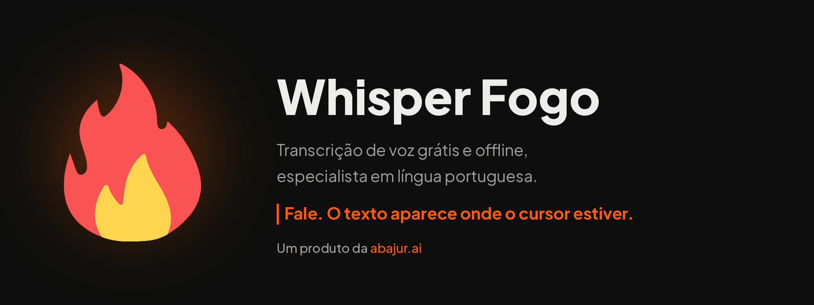
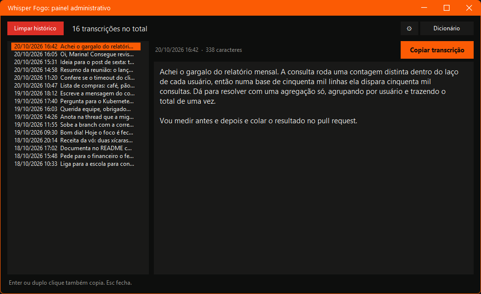
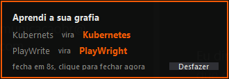
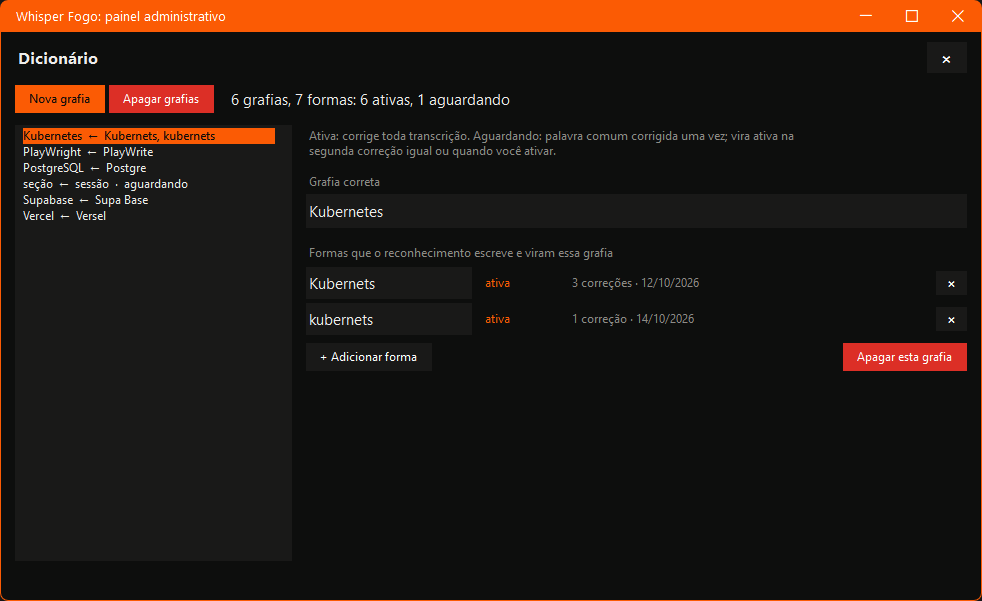
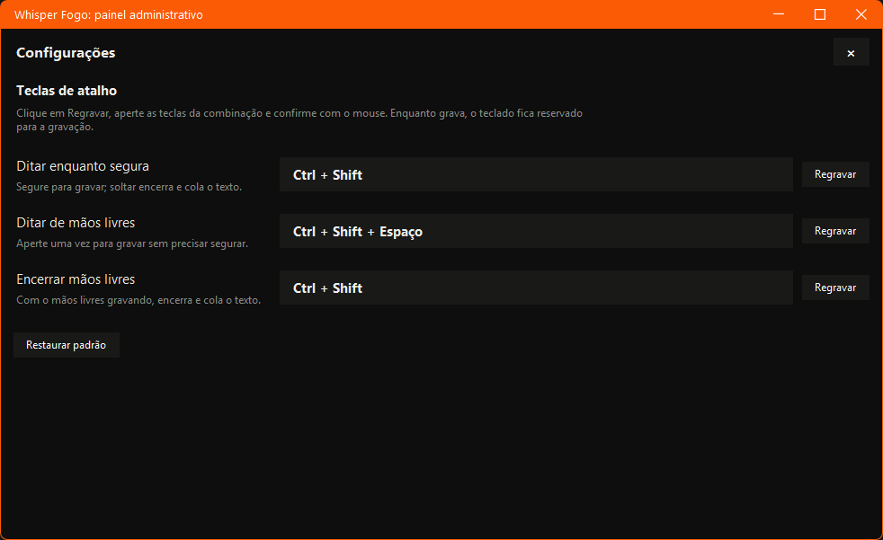

<div align="center">

**Português** · [Read in English](README.en.md)



**Transcrição de voz grátis, que roda inteira na sua máquina e é especialista em língua portuguesa.**

Você fala, o texto aparece onde o cursor estiver. Em qualquer programa.
Sem nuvem, sem mensalidade, sem conta para criar.

<br>

<a href="https://github.com/abajur-ai/whisper-fogo/releases/latest/download/Instalar-Whisper-Fogo.bat"></a>&nbsp;&nbsp;<a href="https://github.com/abajur-ai/whisper-fogo/releases/latest/download/Instalar-Whisper-Fogo.zip"></a>

<sub><b>Windows</b> 10 e 11. <b>macOS</b> 11 em diante no Apple Silicon e 10.15 em diante no Intel.<br>
Na primeira abertura, os dois sistemas mostram um aviso de segurança, porque o programa não é assinado com conta paga.
<a href="#instalação">Veja o passo a passo</a>.</sub>

<br><br>


Um produto da [Abajur](https://abajur.ai).

</div>

---

## Por que ele existe

Ditado por voz bom sempre foi pensado em inglês. As ferramentas que valem a pena
cobram mensalidade, mandam a sua voz para a nuvem e tratam o português como mais
um idioma da lista: escrevem "cloud" quando você disse "Claude", trocam o nome da
sua empresa e esquecem o acento.

O Whisper Fogo começa pelo outro lado. **A língua portuguesa é o idioma principal,
e não um item da lista.** O modelo, a pontuação e o dicionário que aprende as suas
palavras foram afinados para quem fala e escreve em português.

E ele é **grátis** e roda **inteiro no seu computador**. Nenhum áudio, nenhuma
transcrição e nenhuma palavra do seu dicionário saem da sua máquina. Não há conta,
não há servidor para cair, não há limite de minutos.

---

## Novo na versão 1.5: rápido em qualquer computador

Até a versão 1.4, o Whisper Fogo só era rápido com placa de vídeo **NVIDIA**. O
motor de transcrição daquela época, o
[faster-whisper](https://github.com/SYSTRAN/faster-whisper), roda sobre o
[CTranslate2](https://github.com/OpenNMT/CTranslate2), que só sabe usar duas coisas:
o processador e o CUDA, que é exclusivo da NVIDIA. Placa AMD, placa Intel e o chip
dos Macs ficavam de lado, e a transcrição caía para o processador. Na prática, quem
não tinha NVIDIA esperava quase meio minuto para ver uma frase de 10 segundos virar
texto.

**A partir da 1.5, o motor é o [whisper.cpp](https://github.com/ggml-org/whisper.cpp)**,
a mesma base dos programas de transcrição abertos mais usados (Handy, Buzz,
OpenWhispr, Vibe, VoiceInk). Ele conversa com a placa de vídeo pelo **Vulkan** no
Windows, que NVIDIA, AMD e Intel suportam, e pelo **Metal** no Mac. O modelo
continua o mesmo, o Whisper `large-v3-turbo`, e o resto do programa não mudou.

| Computador | Antes (1.4) | Agora (1.5) |
|---|---|---|
| Notebook com NVIDIA | rápido | rápido do mesmo jeito |
| Notebook com placa integrada Intel ou AMD | processador, devagar | placa de vídeo, rápido |
| Placa dedicada AMD ou Intel Arc | processador, devagar | placa de vídeo, rápido |
| Mac com Apple Silicon | processador, devagar | placa do chip, pelo Metal |
| Sem placa de vídeo | processador | processador, mais rápido que antes |

**Medido em 20/10/2026 num mesmo notebook** (Intel Core i7-13700H, Intel Iris Xe
integrada e RTX 4050 de 6 GB), com falas reais em português:

| Onde a transcrição roda | Fala de 11,5 s | Fala de 11 min |
|---|---|---|
| RTX 4050, motor antigo (CUDA) | 0,9 s | 37 s |
| RTX 4050, motor novo (Vulkan) | 1,0 a 1,3 s | 41 a 43 s |
| Intel Iris Xe integrada, motor antigo | 28 a 33 s (processador) | não medido |
| Intel Iris Xe integrada, motor novo | 5,2 s | 145 s |
| Só o processador, motor antigo | 28 a 33 s | não medido |
| Só o processador, motor novo | 19 a 21 s | não medido |

Com NVIDIA a diferença é de décimos de segundo numa fala curta. Na placa integrada,
que é o que a maioria dos notebooks tem, a mesma fala sai de cinco a seis vezes mais
rápido do que saía.

---

## Como usar

| Você faz | No Windows | No macOS | O que acontece |
|---|---|---|---|
| Fala segurando a tecla | `Ctrl` + `Shift` | `Fn` | Grava enquanto segurar e cola o texto ao soltar |
| Fala de mãos livres | `Ctrl` + `Shift` + `Espaço` | `Fn` + `Espaço` | Fala à vontade; `Ctrl` + `Shift` (ou `Fn`) encerra |
| Clica no ícone da chama | na bandeja | na barra de menus | Abre o painel administrativo |
| Corrige uma palavra no campo | | | O programa aprende a sua grafia |

O texto vai para onde o cursor estiver: editor de código, chat, e-mail, terminal,
planilha, formulário no navegador. Se o programa aceita texto, aceita a sua voz.

No Windows, as três teclas podem ser trocadas pelo painel (veja
[Teclas do seu jeito](#teclas-do-seu-jeito)).

---

## O painel administrativo

<div align="center">

</div>

<br>

Tudo o que você falou fica guardado aqui, da mais recente para a mais antiga.

- **Nada se perde.** Toda transcrição é salva antes de ir para a área de
  transferência. Se não havia campo de texto em foco, a colagem cai no vazio, mas o
  texto continua no painel: um clique em **Copiar transcrição** e pronto.
- **Histórico inteiro, sem espera.** A lista carrega em blocos conforme você rola,
  então milhares de transcrições abrem na hora. As setas do teclado andam de uma em
  uma.
- **Limpar o que quiser.** **Limpar histórico** abre caixas de seleção ao lado de
  cada transcrição, com **Selecionar todas**, e pede confirmação antes de apagar.
- **Se a transcrição falhar**, o áudio é guardado em disco em vez de sumir.

---

## Ele aprende as suas palavras

<div align="center">

</div>

<br>

Ditou, o texto colou e você corrigiu uma palavra ali mesmo? O Whisper Fogo percebe,
aprende a grafia certa e passa a acertar sempre. Um aviso no canto da tela mostra o
que foi aprendido, com **Desfazer** para o caso de você não querer.

Não é keylogger: o programa pergunta ao sistema o conteúdo do campo, pelo mesmo
caminho que um leitor de tela usa, e só durante 60 segundos depois de colar. Campo
de senha nunca é lido, e nada disso vai para log nenhum.

### O Dicionário

<div align="center">

</div>

<br>

No botão **Dicionário** do painel você vê tudo o que foi aprendido: cada grafia
certa com todas as formas erradas que levam a ela, e o status de cada uma.

- **Ativa:** corrige toda transcrição.
- **Aguardando:** palavra comum do português corrigida uma vez só. Ela vira ativa
  na segunda correção igual, ou quando você clica em **Ativar**. Nome próprio,
  marca e sigla já entram ativos na primeira.

Ali você edita a grafia certa ou qualquer forma, acrescenta e remove formas, cria
grafias à mão e apaga uma, várias ou todas. Tudo salva sozinho, e a próxima
transcrição já usa o dicionário novo.

Para quem prefere arquivo, o `dicionario.json` aceita trocas fixas, marcas que só
erram a caixa e o vocabulário que o reconhecedor deve esperar ouvir:

```json
{
  "trocas":     { "Cloud Code": "Claude Code", "Verso": "Vercel" },
  "maiusculas": [ "GitHub", "PostgreSQL" ],
  "hotwords":   [ "Kubernetes", "endpoint", "deploy" ],
  "expansoes":  false
}
```

`expansoes` liga a troca de "pra" por "para" e de "tá" por "está" no texto final.
Depois de editar, use **Recarregar dicionário** no menu do ícone.

---

## Teclas do seu jeito

<div align="center">

</div>

<br>

Na engrenagem do painel, cada ação tem **Regravar**: você clica, aperta as teclas
da combinação, vê cada uma aparecer na tela e confirma com o mouse. Vale tecla
única, como as de um teclado de macros (`F13`, `F14`), e vale na hora, sem
reiniciar. O menu do ícone mostra sempre as teclas atuais, e **Restaurar padrão**
volta tudo ao começo.

Disponível no Windows. No macOS as teclas são as do sistema (`Fn`).

---

## Sempre pronto e sempre atualizado

- **Abre junto com o sistema.** Ligou o computador, a chama está na bandeja.
  O Whisper Fogo aparece com o próprio nome e ícone onde o sistema lista o que
  abre junto: no Windows, em Gerenciador de Tarefas > Aplicativos de
  inicialização; no macOS, em Ajustes > Geral > Itens de Início. Quem não quiser
  desliga ali, e a escolha é respeitada.
- **Avisa quando há versão nova.** A cada vez que abre, o programa confere a última
  versão publicada aqui. Se houver novidade, aparece um aviso e o item
  **Atualizar para a versão X** no menu do ícone. A atualização preserva o seu
  histórico, o seu dicionário e as suas teclas, e o programa reinicia sozinho.
- **Verificar atualização**, no mesmo menu, faz a conferência na hora que você quiser.

No macOS é igual: a atualização troca só o código do programa, e as permissões de
microfone e acessibilidade continuam valendo.

---

## Instalação

### Para quem só quer usar

Clique no botão do seu sistema, o arquivo baixa e você dá dois cliques nele. O
instalador confere se a sua máquina aguenta, instala tudo numa pasta isolada,
baixa o motor e o modelo, prepara a placa de vídeo, cria os atalhos e abre o
programa. Não mexe em nada fora da pasta dele.

<div align="center">

<a href="https://github.com/abajur-ai/whisper-fogo/releases/latest/download/Instalar-Whisper-Fogo.bat"></a>&nbsp;&nbsp;<a href="https://github.com/abajur-ai/whisper-fogo/releases/latest/download/Instalar-Whisper-Fogo.zip"></a>

</div>

Nos dois sistemas o programa não é assinado com conta paga, então na primeira vez
aparece um aviso de segurança. Ele faz parte do caminho e some depois da primeira
autorização.

**No Windows**

1. Dê dois cliques no arquivo baixado.
2. O Defender pergunta se você confia. Clique em **Mais informações** e depois em
   **Executar assim mesmo**.
3. A instalação corre até o fim, cria o atalho no Desktop e no menu Iniciar e abre
   o programa na bandeja.

**No macOS**

1. O download é um arquivo compactado. Dê dois cliques nele para sair o aplicativo
   **Instalar Whisper Fogo**.
2. Dê dois cliques no aplicativo. O sistema mostra **"o item não foi aberto"**:
   feche no botão **Concluído**, e não em Mover para o Lixo.
3. Abra **Ajustes do Sistema > Privacidade e Segurança**, role até o fim, na seção
   **Segurança**, e clique em **Abrir Mesmo Assim** na linha do Instalar Whisper
   Fogo. Se a linha não estiver lá, abra o aplicativo de novo para o aviso
   reaparecer.
4. Dê dois cliques no aplicativo mais uma vez. A instalação corre até o fim, o
   programa abre na barra de menus, ganha ícone no Dock e passa a abrir junto com
   o Mac.

Na primeira gravação, o macOS pede **Microfone** e **Acessibilidade**, as duas em
nome do Whisper Fogo. É uma vez só: as atualizações seguintes não pedem de novo.

O instalador também reserva a tecla `Fn` para o Whisper Fogo. Sozinha, ela deixa de
abrir o ditado da Apple, os emojis ou a troca de idioma, que disparariam junto com
cada ditado.

### Para quem quer mexer no código

```bash
git clone https://github.com/abajur-ai/whisper-fogo.git
cd whisper-fogo

# Windows
powershell -ExecutionPolicy Bypass -File instalador/instalar.ps1

# macOS
bash instalador/instalar.sh
```

O instalador detecta que você está dentro do repositório e usa os seus arquivos
locais em vez de baixar de novo.

### O que a sua máquina precisa ter

Velocidades **medidas** em 20/10/2026 num notebook com Intel Core i7-13700H, Intel
Iris Xe integrada e RTX 4050 de 6 GB, com 11 minutos de fala real em português.

**No Windows**

|  | Mínimo | Recomendado | Ideal |
|---|---|---|---|
| **Sistema** | Windows 10, 64 bits | Windows 10 ou 11 | Windows 11 |
| **Placa de vídeo** | nenhuma, roda no processador | integrada recente (Intel Iris Xe, AMD Radeon) | dedicada NVIDIA, AMD ou Intel Arc com 4 GB ou mais |
| **Memória da placa livre** | zero | usa a memória do sistema | 2 GB |
| **Memória RAM** | 4 GB | 8 GB | 16 GB ou mais |
| **Disco** | 1,1 GB | 1,8 GB | 1,8 GB |
| **Velocidade** | ~0,6x o tempo real | ~4,6x | ~16x |

**No macOS**

|  | Mínimo | Recomendado | Ideal |
|---|---|---|---|
| **Chip** | Intel Core i5 (só processador) | Apple Silicon M1 ou M2 | Apple Silicon Pro, Max ou M3 em diante |
| **Sistema** | macOS 10.15 (Intel) ou 11 (Apple Silicon) | macOS 13 | macOS 14 ou mais novo |
| **Memória RAM** | 8 GB | 8 GB | 16 GB ou mais |
| **Disco** | 1,1 GB | 1,8 GB | 1,8 GB |
| **Velocidade** | não medida (Intel, só processador) | ~6x o tempo real (M1) | não medida |

No Apple Silicon a transcrição usa a placa do chip pelo Metal. Medido em 20/10/2026
num MacBook Air M1 de 8 GB: 10 segundos de fala em 2,9 segundos e 39 segundos em
6,2 segundos.

**Traduzindo a velocidade:** é quantas vezes mais rápido que o tempo real. Com uma
placa dedicada, 1 minuto de fala vira texto em uns 4 segundos. Numa placa
integrada, em uns 13 segundos. Só no processador, em uns 1 minuto e 40 segundos.

**Quanto ocupa da placa de vídeo:** cerca de 1,9 GB, o modelo de 1,6 GB mais o
espaço de cálculo. Depois de 10 minutos sem uso, o modelo sai da memória da placa
sozinho.

<details>
<summary><b>Como o motor usa a sua placa de vídeo</b></summary>

<br>

- **Qual placa.** No Windows, o motor pergunta ao Vulkan quais placas existem. Num
  notebook com placa integrada e placa dedicada, a dedicada é a escolhida, mesmo
  quando o Windows lista a integrada primeiro. Só com a integrada, é ela que
  trabalha. No Mac com Apple Silicon, a placa é a do chip, pelo Metal.
- **Sem placa que sirva.** O Vulkan vem no driver de vídeo da NVIDIA, da AMD e da
  Intel. Sem ele, ou se a placa falhar ao carregar o modelo, a transcrição segue no
  processador, sozinha, sem você fazer nada.
- **Duas precisões do mesmo modelo.** Na placa, o `large-v3-turbo` roda na precisão
  cheia (1,6 GB). No processador, roda em 8 bits (0,9 GB), que é uma vez e meia
  mais rápido ali, com o mesmo texto. O instalador baixa só a que a sua máquina usa.
- **A primeira vez numa placa.** O driver de vídeo compila os programas do motor
  na primeira transcrição, e ela levaria dezenas de segundos. Por isso o instalador
  faz uma transcrição de teste no fim, e o driver guarda o resultado. A sua
  primeira fala de verdade já sai no tempo normal.
- **Driver de vídeo atualizado com o programa aberto.** Se o motor cair, ele sobe
  de novo sozinho e repete a transcrição. Se ainda assim falhar, o áudio fica
  guardado em disco.

</details>

---

## O que é instalado

| Componente | Tamanho | Para quê |
|---|---|---|
| Whisper `large-v3-turbo` | 1,6 GB com placa de vídeo, 0,9 GB sem | Transcrever a fala |
| Motor [whisper.cpp](https://github.com/ggml-org/whisper.cpp) | 58 MB no Windows, 9 MB no Mac | Rodar o modelo na placa ou no processador |
| Python isolado e bibliotecas | ~120 MB | O programa em si |

O motor é compilado a partir do código do whisper.cpp pelo próprio GitHub deste
repositório, e o programa confere o SHA-256 de cada arquivo baixado antes de usar.

**Velocidade medida** numa RTX 4050 de notebook: 11 minutos de fala transcritos em
42 segundos, 16 vezes mais rápido que o tempo real. Falas curtas do dia a dia saem
em 1 a 3 segundos.

---

## Privacidade e desempenho, em números

- **0 bytes** enviados durante o uso. A internet só entra para baixar o programa, o
  motor e o modelo, uma vez, e para conferir se há versão nova.
- **127.0.0.1** é o único endereço em que o motor escuta: ele roda num processo ao
  lado do programa e não aceita conexão de fora da sua máquina.
- **0 conta** para criar. Não há login, telemetria nem servidor.
- **0 arquivo de áudio** guardado: a gravação vive na memória só até virar texto.
- **60 segundos** é a janela em que o programa observa o campo para aprender a sua
  grafia. Fora dela, ele não olha nada.
- **1 hora** de fala contínua por gravação, o teto contra microfone esquecido aberto.
- **10 minutos** sem uso e o modelo devolve a memória da placa de vídeo.

---

## Como o programa é feito

Python puro, sem framework, sem Electron. O reconhecimento roda no `whisper-server`
do whisper.cpp, num processo ao lado, que o programa sobe, usa e encerra sozinho.
Cada arquivo faz uma coisa:

| Arquivo | Responsabilidade |
|---|---|
| `voz.py` | O programa: ícone, gravação, transcrição, colagem, início com o sistema |
| `motor.py` | O motor: baixa, escolhe a placa, sobe o servidor e transcreve |
| `teclado.py` | O atalho global, com a máquina de estados de segurar e de mãos livres |
| `atalhos.py` | As combinações de teclas, o padrão e o nome de cada tecla |
| `historico.py` | O registro em disco e o painel administrativo |
| `grafias.py` | O Dicionário do painel |
| `configuracoes.py` | As configurações do painel, com a regravação de teclas |
| `tema.py` | O visual: cores, barra de título, botões, camadas e rolagem |
| `aprendizado.py` | Decide o que vira grafia a partir das suas correções |
| `observador.py` | Lê o campo pela API de acessibilidade e observa por 60 segundos |
| `corrigir.py` | Aplica o dicionário na transcrição |
| `atualizacao.py` | Confere e aplica a versão publicada aqui |
| `aviso.py` | O aviso de grafia aprendida, com desfazer |
| `clip.py` | Área de transferência e colagem, por sistema |
| `caminhos.py` | Onde ficam o código e os dados em cada sistema |
| `executavel.py` | O `Whisper Fogo.exe` do Windows, com o nome e o ícone do programa |

**Testes:** 152 asserts, rodando sem microfone e sem placa de vídeo, e sem tocar nos
seus dados:

```bash
cd whisper_fogo
python corrigir.py         # dicionário e expansões
python observador.py       # âncora e janela de observação
python tema.py             # corte de títulos e barra de rolagem
python grafias.py          # regras do Dicionário
python atalhos.py          # combinações de teclas
python atualizacao.py      # comparação de versões e troca do código
python motor.py            # escolha da placa, download conferido e montagem do texto
python historico.py --teste
python teste_corte.py      # gravação longa, corte de segurança e cor do ícone
python executavel.py --teste   # Windows: nome, editora e ícone do Whisper Fogo.exe
```

---

## Windows e macOS

| Recurso | Windows | macOS |
|---|---|---|
| Ditado com atalho global | `Ctrl` + `Shift` | `Fn` |
| Teclas regraváveis | sim | não, usa `Fn` |
| Colagem no cursor | sim | sim |
| Transcrição | placa NVIDIA, AMD ou Intel (Vulkan), ou processador | placa do Apple Silicon (Metal); Mac Intel no processador |
| Painel administrativo e Dicionário | sim | sim |
| Aprender pela sua correção | UI Automation | API de Acessibilidade |
| Abre com o sistema | sim | sim |
| Atualização | dentro do programa | dentro do programa |

**No Windows** o Whisper Fogo fica em `AppData\Local\WhisperFogo`, com o Python e
as bibliotecas numa pasta isolada, atalho no Desktop e no menu Iniciar e a chama na
bandeja ao lado do relógio.

**No macOS** ele é um aplicativo em `~/Applications`, na barra de menus e no Dock.
O aplicativo é só o interpretador, com o nome e o ícone do Whisper Fogo, e é a ele
que o macOS concede microfone e acessibilidade. O código, as bibliotecas, o modelo e
os seus dados ficam em `~/Library/Application Support/WhisperFogo`, e é só essa
pasta que a atualização troca: o aplicativo não muda, e as permissões continuam
valendo.

---

## Perguntas frequentes

**Minha voz vai para algum servidor?**
Não. O modelo roda na sua máquina. Você pode desligar a internet depois de instalar
e o programa continua funcionando igual.

**É grátis mesmo?**
É. Sem plano pago, sem limite de minutos, sem anúncio.

**Funciona em qualquer programa?**
Em qualquer campo de texto que aceite colar.

**Precisa de placa de vídeo cara? Precisa ser NVIDIA?**
Não e não. Desde a versão 1.5, qualquer placa com Vulkan serve: NVIDIA, AMD ou
Intel, dedicada ou a integrada do notebook. No Mac com Apple Silicon, a do chip.
Sem placa nenhuma, roda no processador, mais devagar.

**Por que a primeira transcrição do dia demora mais?**
O modelo carrega na primeira vez que você fala, o que leva alguns segundos. Depois
fica na memória até você passar 10 minutos sem falar.

**Eu já usava a versão 1.4. O que muda para mim?**
Nada na tela nem no uso: histórico, Dicionário, teclas e grafias aprendidas ficam
como estão. Depois de atualizar pelo menu do ícone, o programa baixa sozinho o
motor novo e o modelo, em segundo plano, logo que abre. Se você ditar antes de o
download terminar, essa primeira transcrição espera por ele. No Mac, quem vem da 1.4
instala uma última vez pelo botão de download e autoriza microfone e acessibilidade
de novo; daí em diante, a atualização é pelo menu e as permissões ficam.

**Ele funciona em inglês?**
O reconhecedor entende dezenas de idiomas, mas tudo aqui é afinado para português:
o dicionário, a pontuação, a lista de palavras comuns.

**Posso usar no trabalho?**
Pode. A licença é MIT, e como nada sai da máquina, nenhum dado de cliente trafega
para fora.

---

## Contribuir

Issue e pull request são bem-vindos. O que mais ajuda:

1. **Casos em que a transcrição erra feio** em português, com o áudio se possível.
2. **Palavras que o aprendizado deveria ou não deveria ter pegado.**
3. **Relatos de Macs e de versões do macOS que não testamos**, principalmente Intel.
4. **Medições em placas que não testamos**, principalmente AMD e Intel Arc: o
   tempo de uma fala e o nome da placa.

O código é escrito e comentado em português, explicando o porquê das decisões.

---

## Créditos

Construído sobre o [whisper.cpp](https://github.com/ggml-org/whisper.cpp) e o
modelo [Whisper](https://github.com/openai/whisper), com o detector de fala
[Silero VAD](https://github.com/snakers4/silero-vad). Até a versão 1.4 o motor era o
[faster-whisper](https://github.com/SYSTRAN/faster-whisper). A lista de palavras comuns do
português vem do [FrequencyWords](https://github.com/hermitdave/FrequencyWords).

---

<div align="center">

Um produto da **[Abajur](https://abajur.ai)**
Licença [MIT](LICENSE)

</div>
